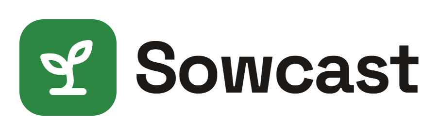
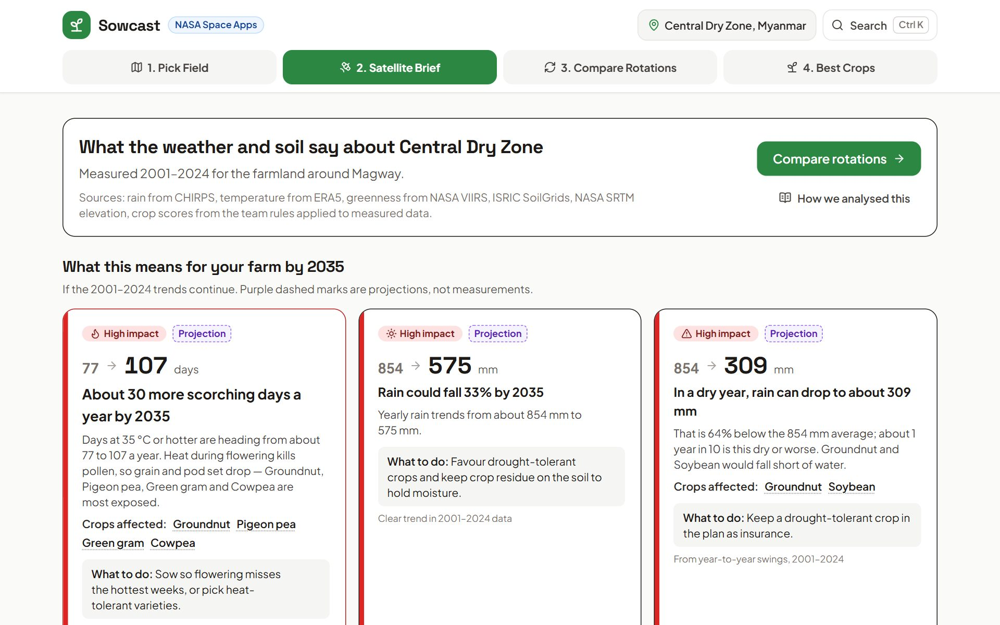

<p align="center">
  
</p>

<p align="center"><strong>Know what your land can grow before you plant it.</strong><br /><a href="https://sow-cast.vercel.app">https://sow-cast.vercel.app</a></p>

<p align="center">
  Sowcast turns 24 years of NASA and open satellite data into a rain calendar, a 2035 outlook and crop rotations
  for farms in Southeast Asia, then hands the farmer a plan they can print.<br />
  Built for the NASA Space Apps Challenge.
</p>

<p align="center">
  
</p>

## What it does

1. **Pick your field.** 31 farming regions in Myanmar, Thailand, Vietnam, Cambodia and Malaysia on a map coloured by plant greenness.
2. **Read the satellite brief.** Rain against crop water need month by month, heat days, downpours, dry spells and soil, measured 2001–2024. Trends are projected to 2035 and turned into plain consequences ("about 30 more scorching days a year by 2035": which crops suffer and what to do). The area is shown from space in its barest and greenest months.
3. **Compare rotations.** What farmers do now, next to the three best rotations for a goal (soil health, market value, saving water, low risk, low cost), each with a month-by-month crop calendar and scores against current practice. Or lay out your own rotation in the drag-and-drop builder.
4. **Pick crops and take the plan.** 25 crops ranked for your goal, each with planting window, harvest, yield, inputs and a farmer tip. Download a printable PDF plan (rotation, crops, how to grow them, notes on the area, a season checklist), which can be translated in the browser before printing.

There is also a **Claude skill**, so farmers and extension workers can ask Claude the same questions in chat, for any location (see below).

## Data and methods

All data is open and keyless. Every number in the app carries its source, and projections are labelled as projections.

| Data | Source | Used for |
|---|---|---|
| Daily rain, 2001–2024 | CHIRPS 2.0 via SERVIR ClimateSERV | Rain calendar, trends, water balance |
| Daily temperature and crop water demand | NASA POWER (elevation-corrected); ERA5 via Open-Meteo where POWER has a known 2008 break | Heat days, temperature fit, ET0 |
| Plant greenness | NASA GIBS (MODIS/VIIRS NDVI) | Growing season, bare-soil months, map layer, satellite views |
| Soil | ISRIC SoilGrids 2.0 | Texture, organic matter, drainage, water holding |
| Elevation and slope | NASA SRTM | Erosion risk, temperature correction |
| Regions, crop traits, planting calendars, rotations | Sowcast team tables from field studies (Cornish 2018, Herridge 2019, Vityakon 2007, Toomsan et al., FAO) | Crop scores, rotation recommender |

Trends use the Mann-Kendall test and Theil–Sen slopes; projections extend clear trends to 2035 with an 80% range for a single year; crops are re-scored with the team's rules at today's, projected and bad-year conditions. The full write-up is in [data/ANALYSIS.md](data/ANALYSIS.md) and on the in-app Methods page.

Scores are rules of thumb, not field trials. Sowcast suggests options; farmers should check with local agricultural experts.

## Claude skill

The `sowcast-advisor` skill teaches Claude to explain a farm's climate and soil, check a farmer's own rotation month by month, recommend rotations and help put them into practice. It bundles the app's data and fetches live data (ERA5, CHIRPS, SoilGrids) for any coordinates.

```
/plugin marketplace add aungmyintunsoe/Sow-cast
/plugin install sowcast@sowcast
```

For claude.ai, other install options and example prompts, see [skill/README.md](skill/README.md) or the app's Claude skill page.

## Run it locally

```bash
npm install
npm run dev        # http://localhost:3000
npm run build      # type-check and production build into dist/
```

Node 18 or later. The app is a static site: all data is pre-built JSON in `public/data`.

## Deploy

Vercel picks up `vercel.json`: `npm ci`, `npm run build`, output `dist/`, with security and caching headers. No environment variables are needed. Live at https://sow-cast.vercel.app. If the domain changes, update the URLs in `index.html`, `public/robots.txt` and `public/sitemap.xml`.

## Project structure

```
src/
  components/
    landing/     home page, Claude skill page, animated field background
    map/         step 1: region picker and map layers
    brief/       step 2: satellite brief, 2035 outlook, charts, satellite views
    rotations/   step 3: rotation comparison, crop calendars, rotation builder
    crops/       step 4: crop ranking, crop detail cards
    plan/        printable PDF plan
    methods/     how the data was analysed
    layout/ ui/  header, command menu (Ctrl/⌘ K), shared UI
  hooks/ lib/ types/
public/
  data/          generated app data (do not edit by hand)
  landing/ brand/  screenshots, logo, social preview
data/            the data pipeline (Node + Python), team inputs and methods docs → data/README.md
skill/           the Claude skill and plugin → skill/README.md
.claude-plugin/  marketplace file that lets Claude Code install the skill from this repo
```

To rebuild the data from scratch, see [data/README.md](data/README.md) (`node data/scripts/run_all.mjs`).

## Built with

React 18, TypeScript, Vite, Tailwind CSS, Framer Motion, Recharts, Leaflet, cmdk and Lucide icons. Data pipeline in Node and Python (pandas, pymannkendall, SciPy).

## Licence

MIT, see [LICENSE](LICENSE). Data remains under its providers' terms (NASA, CHC/UCSB, ECMWF/Copernicus, ISRIC).
